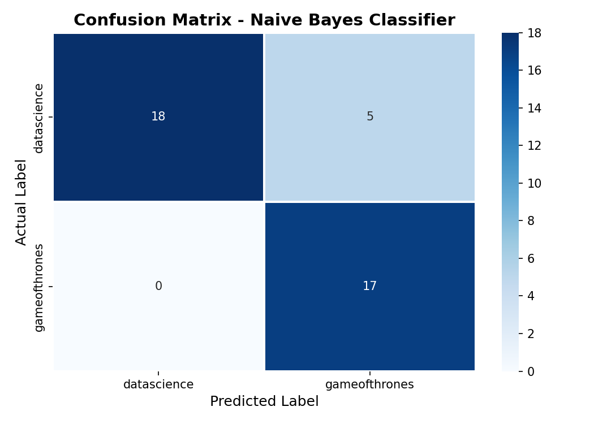
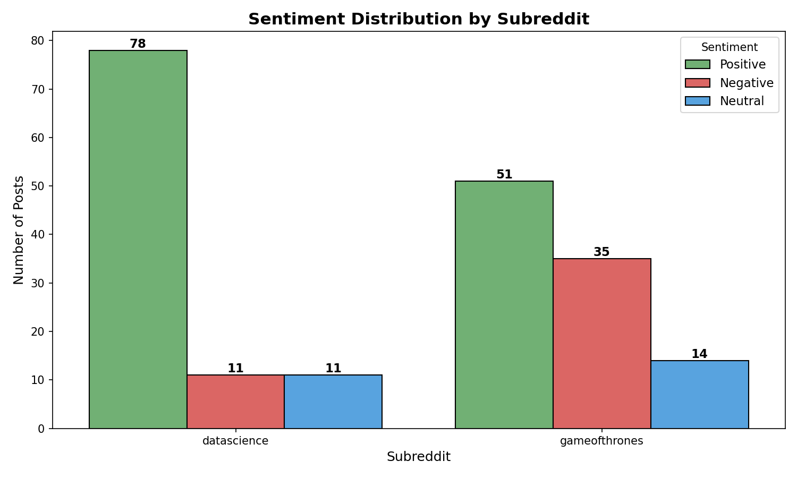
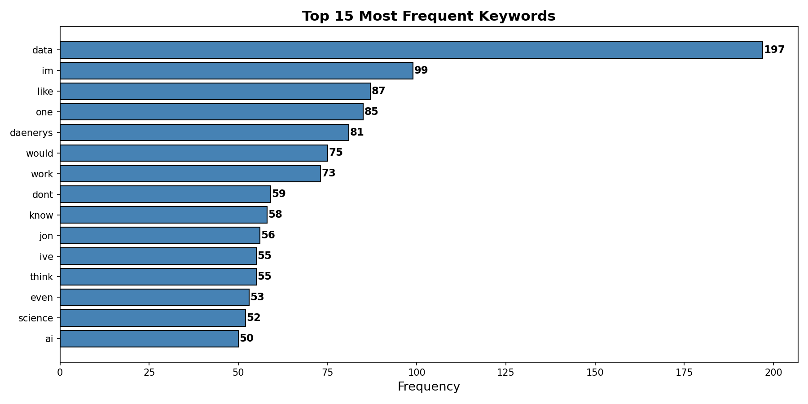
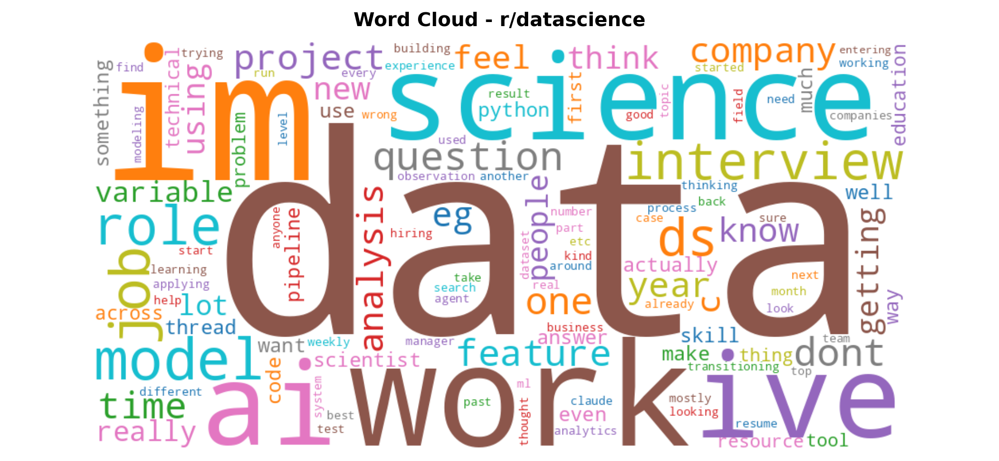

# Reddit Text Analysis and Classification

Introduction to Data Science, Assignment 4.

This project pulls posts from two subreddits, cleans the text, finds the sentiment of each post, and trains a model that guesses which subreddit a post came from. The results are shown in Python charts and a Power BI dashboard.

## What it does

1. Connects to Reddit with PRAW and fetches 100 hot posts each from r/datascience and r/gameofthrones.
2. Cleans the text. Removes links, punctuation and stopwords, then lowercases and tokenizes it.
3. Builds word histograms and finds hapaxes for each subreddit.
4. Trains an NLTK Naive Bayes classifier on the top 200 words (80/20 train/test split).
5. Scores each post as Positive, Negative or Neutral with VADER.
6. Makes charts in Matplotlib and Seaborn, then builds a dashboard in Power BI.

## Results

* Classifier accuracy: **87.5%** on 40 test posts
* Sentiment across 200 posts: 129 Positive, 46 Negative, 25 Neutral
* Top words for r/datascience: work, ai, using, company, job

| Confusion matrix | Sentiment by subreddit |
| --- | --- |
|  |  |

| Keyword frequency | Word cloud (r/datascience) |
| --- | --- |
|  |  |

## Project structure

```
notebook/     Jupyter notebook and its HTML export
data/         Raw and classified Reddit data (CSV)
dashboard/    Power BI dashboard (.pbix)
report/       Summary report (PDF) and full report (DOCX)
screenshots/  Charts made by the notebook
```

## How to run

1. Install the packages:
   ```
   pip install -r requirements.txt
   ```
2. Create a Reddit app at https://www.reddit.com/prefs/apps and copy the client ID and secret.
3. Open `notebook/reddit_text_analysis.ipynb` and put your keys in the Reddit API cell.
4. Run all cells.

To see the dashboard, open `dashboard/reddit_dashboard.pbix` in Power BI Desktop.

## Tools

Python, PRAW, NLTK, VADER, Pandas, Matplotlib, Seaborn, WordCloud, scikit-learn, Power BI.
